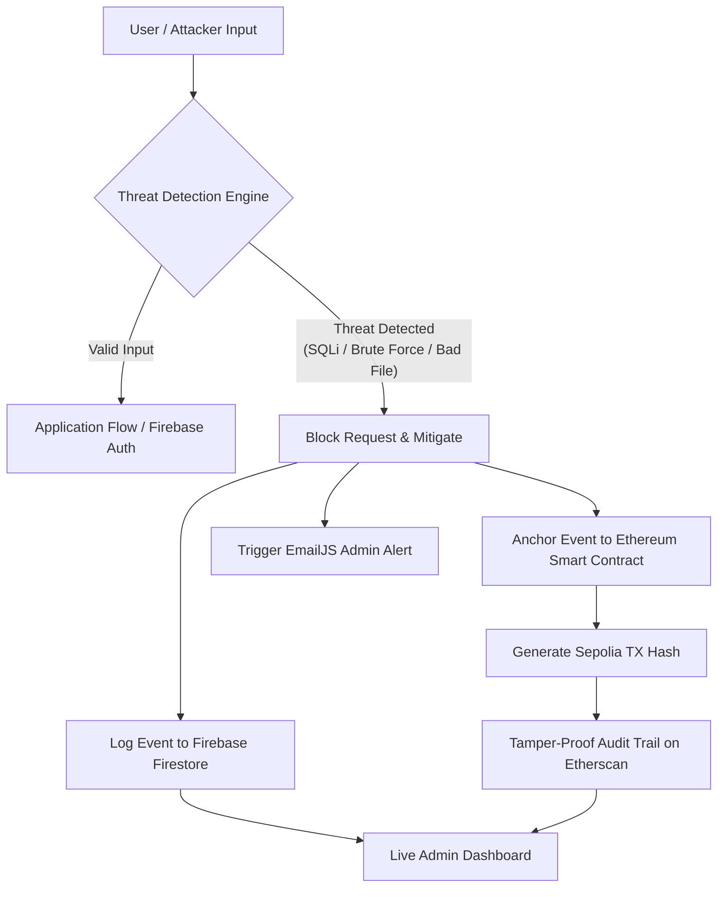

# 🛡️ BlockSecure — Blockchain-Based Malicious Activity Detector

[](https://nextjs.org/)
[](https://www.typescriptlang.org/)
[](https://soliditylang.org/)
[](https://sepolia.etherscan.io/)
[](https://firebase.google.com/)
[](https://tailwindcss.com/)
[](LICENSE)

**BlockSecure** is an enterprise-grade cybersecurity platform that combines proactive threat mitigation with decentralized blockchain audit logging. By anchoring critical security incidents (such as SQL injection, brute force login attempts, and malicious file uploads) directly onto the Ethereum blockchain, BlockSecure creates an immutable, tamper-evident audit trail that cannot be manipulated or erased by adversaries or insiders.

---

## 🌟 Key Features

- **🔍 SQL Injection (SQLi) Defense Engine**: Real-time pattern inspection and heuristic analysis detecting boolean tautologies (e.g., `' OR 1=1 --`), UNION-based leaks, stacked queries, and database-specific time-based injection attacks (`SLEEP`, `BENCHMARK`, `pg_sleep`).
- **🔒 Brute Force Protection & Lockout**: Granular per-account tracking of failed login attempts with progressive alerts and automated 5-minute cool-down lockouts after 5 consecutive failures.
- **📁 Secure File Upload Sanitizer**: Strict whitelist validation for authorized file extensions and MIME types, with high-risk executable filtering (`.exe`, `.bat`, `.sh`, `.php`, `.dll`, etc.) and optional signed cloud uploads via Cloudinary.
- **⛓️ Immutable Ethereum Blockchain Logging**: Deploys `SecurityLogger.sol` to Ethereum Sepolia testnet to record every security event with cryptographic proof, timestamp, and transaction hash.
- **📧 Real-Time Administrator Alerts**: Automated notification pipeline powered by EmailJS, sending critical incident reports directly to administrators with Etherscan verification links.
- **📊 Unified Admin Operations Dashboard**: Live administrative command center for monitoring threats, inspecting on-chain cryptographic proofs, viewing locked accounts, and managing uploaded assets.

---

## 📐 Architecture & Detection Pipeline



---

## 📜 Smart Contract Architecture

The decentralized audit log is maintained by **`SecurityLogger.sol`**, deployed on the Ethereum Sepolia testnet.

### Contract Highlights:
- **`logSecurityEvent(string eventType, string details, string severity, string userId)`**: Creates a keccak256 hash identifying the event, pushes the record into on-chain storage, and emits an `EventLogged` event.
- **`getSecurityEvent(bytes32 eventId)`**: Returns immutable event data (`eventType`, `details`, `severity`, `userId`, `timestamp`).
- **`getTotalEvents()` & `getEventIdByIndex(uint256 index)`**: Enables deterministic traversal of the full audit history.

Contract file location: [`contracts/SecurityLogger.sol`](contracts/SecurityLogger.sol)

---

## 🛠️ Technology Stack

| Component | Technology | Purpose |
|---|---|---|
| **Frontend Framework** | [Next.js 15 (App Router)](https://nextjs.org/) | Server & Client Components, API routes |
| **Language** | [TypeScript 5](https://www.typescriptlang.org/) | End-to-end type safety |
| **Styling** | [Tailwind CSS 3](https://tailwindcss.com/) & Radix UI | Modern responsive user interface |
| **Smart Contracts** | [Solidity ^0.8.30](https://soliditylang.org/) | Ethereum event logger contract |
| **Web3 Provider** | [Ethers.js v5](https://docs.ethers.org/v5/) | Blockchain interaction & wallet transactions |
| **Database & Auth** | [Firebase](https://firebase.google.com/) | Authentication & Firestore document persistence |
| **Email Service** | [EmailJS](https://www.emailjs.com/) | Instant administrative email alerts |
| **File Storage** | [Cloudinary](https://cloudinary.com/) | Signed file upload and management |

---

## 🚀 Quickstart Guide

### 1. Prerequisites
Ensure you have the following installed on your machine:
- **Node.js**: v18.0.0 or later (tested up to Node.js v25)
- **npm** or package manager of choice
- **Ethereum Wallet**: MetaMask or private key funded with Sepolia Testnet ETH (e.g. from Sepolia Faucet)

### 2. Clone the Repository
```bash
git clone https://github.com/Reiyonnaise/Blockchain-Based-Malicious-Activity-detector.git
cd Blockchain-Based-Malicious-Activity-detector
```

### 3. Install Dependencies
```bash
npm install
```

### 4. Configure Environment Variables
Copy the sample environment file to create your local environment:
```bash
cp .env.example .env.local
```

Populate the `.env.local` file with your credentials (see table below).

### 5. Run Development Server
```bash
npm run dev
```

Open [http://localhost:3000](http://localhost:3000) in your browser to access BlockSecure.

### 6. Build for Production
```bash
npm run build
npm run start
```

---

## ⚙️ Environment Variables Reference

| Variable | Required | Description |
|---|---|---|
| `NEXT_PUBLIC_CONTRACT_ADDRESS` | Yes | Address of the deployed `SecurityLogger` contract on Sepolia. |
| `NEXT_PUBLIC_ETHEREUM_RPC_URL` | Yes | Public RPC endpoint (e.g., `https://rpc.sepolia.org` or Infura). |
| `ETHEREUM_RPC_URL` | Optional | Server-side RPC endpoint for transaction broadcasting. |
| `PRIVATE_KEY` | Optional | Private key for signing blockchain logging transactions. |
| `NEXT_PUBLIC_EMAILJS_SERVICE_ID` | Optional | EmailJS service identifier for alerts. |
| `NEXT_PUBLIC_EMAILJS_TEMPLATE_ID` | Optional | EmailJS template identifier. |
| `NEXT_PUBLIC_EMAILJS_PUBLIC_KEY` | Optional | EmailJS public key. |
| `NEXT_PUBLIC_ADMIN_EMAIL` | Optional | Target email address to receive administrative threat alerts. |
| `NEXT_PUBLIC_CLOUDINARY_CLOUD_NAME`| Optional | Cloudinary cloud name for file uploads. |
| `CLOUDINARY_API_KEY` | Optional | Cloudinary API Key. |
| `CLOUDINARY_API_SECRET` | Optional | Cloudinary API Secret. |

> *Note: If blockchain or email credentials are omitted, the application falls back gracefully with simulated proof hashes and local notification caching so development and demonstrations run smoothly.*

---

## 🧪 Testing Security Features & Attack Demonstrations

BlockSecure includes dedicated demonstration panels on the Login and Registration pages to test and showcase attack detection:

### 1. SQL Injection (SQLi)
- Navigate to `/login` or `/register`.
- Enter common SQLi attack vectors into form fields, such as:
  ```sql
  ' OR 1=1 --
  admin' --
  ' UNION SELECT null, null, null --
  1' OR '1'='1
  ```
- **Observed Behavior**: The system detects the payload, blocks form processing, logs the event to Firestore and Ethereum, and prompts a security warning.

### 2. Brute Force Protection
- Attempt to sign in with an invalid password 5 consecutive times for an account.
- **Observed Behavior**: After 5 attempts, the account enters a 5-minute cooldown lockout with an interactive countdown timer. Further login attempts are rejected during this window.

### 3. Unauthorized File Uploads
- Navigate to `/dashboard` (after signing in).
- Attempt to upload malicious file types (e.g., `.exe`, `.bat`, `.php`, `.sh`).
- **Observed Behavior**: File validation blocks the upload immediately and logs an `UNAUTHORIZED_FILE_UPLOAD` event to the blockchain.

### 4. Admin Incident Review
- Log in to `/admin-login` with authorized administrator credentials.
- View real-time security events, transaction hashes, locked accounts, and system health status.

---

## 🔐 Security Best Practices

1. **Protect Private Keys**: Never commit `.env` or `.env.local` files to version control.
2. **Rotate Credentials**: Keep admin email lists and API keys restricted to authorized personnel.
3. **Smart Contract Verification**: Verify deployed contracts on [Sepolia Etherscan](https://sepolia.etherscan.io/) for public transparency.

---

## 📄 License

This project is licensed under the [MIT License](LICENSE).